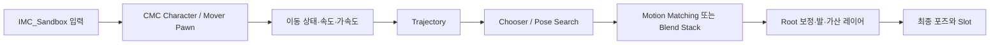

# 이동 모델과 애니메이션 데이터 흐름

## 설치본의 실제 연결

배치 순서는 모델과 경로에 따라 다르므로 이 그림은 데이터의 의존 관계를 나타낸다. 정확한 pose link 순서는 각 AnimGraph의 관측 결과를 사용한다.

입력은 `/Game/Input/IMC_Sandbox`의 **`defaultKeyMappings.mappings`**에서 확인했다. 이전 배열 `mappings`만 읽으면 빈 입력으로 오판할 수 있다. W/A/S/D는 `IA_Move`, LeftControl은 `IA_Walk`, LeftShift는 `IA_Sprint`, SpaceBar는 Jump와 Traverse, C는 Crouch, MiddleMouseButton은 Strafe, RightMouseButton은 Aim, M은 시각 캐릭터 교체, N은 Pawn 교체에 연결된다.

Mover의 실제 주요 함수는 다음과 같다.

1. `Update_PropertiesFromCharacter`가 캐릭터 쪽 값을 애니메이션에 전달한다.
2. `Update_CVarDrivenVariables`가 CVar 기반 설정을 읽는다.
3. `Update_Logic`과 `Update_EssentialValues`·`Update_States`가 속도·가속도·상태를 계산한다.
4. `Update_Trajectory`가 predictor를 사용해 궤적을 만들고 과거·미래 속도와 각속도 등을 추출한다.
5. 선택된 locomotion 경로가 애니메이션을 선택하며, 보정·레이어와 최종 포즈가 이어진다.

`BlueprintThreadSafeUpdateAnimation`에는 `HasOwningActor`, `HasMover`, `UseThreadSafeUpdateAnimation` 조건이 있다. 클래스 기본값만 보고 실제 실행 스레드를 판단하면 안 된다. `DDCVar.ThreadSafeAnimationUpdate.Enable`을 읽는 경로가 있으며, Property Access 노드도 실제 그래프에서 확인했다. 임의의 UObject 호출을 thread-safe 함수로 옮겨도 된다는 의미는 아니다. 게임 스레드의 상태 수집과 안전한 데이터 전달을 유지한다. [공식 애니메이션 최적화 설명](https://dev.epicgames.com/documentation/en-us/unreal-engine/animation-optimization-in-unreal-engine)

## CMC와 Mover의 차이

CMC는 CharacterMovement를 기반으로 캡슐 이동과 캐릭터 상태를 전달한다. Mover 설치본은 CharacterMover와 predictor를 사용한다. Mover의 Trajectory를 CMC의 궤적 생성 파라미터와 동일하게 취급하지 않는다.

두 AnimGraph에는 Motion Matching·Pose History·기본 Slot·Offset Root Bone·관성화와 Dead Blending 경로가 있다. CMC에는 Additive Lean/Aim Offset, Leg IK·Foot Placement가 직접 보이며, Mover는 `Procedural_Feet`, `Procedural_PreLayering`, `AdditiveLeans`, `AimOffset`, `Procedural_FullBody` 등 Linked Anim Layer를 사용한다. 이 노드들의 존재와 특정 조건에서의 실효는 구분한다.

현재 CMC의 authored Offset Root Bone 설정은 Rotation=Accumulate, Translation=Interpolate였다. 이를 Mover나 모든 캐릭터의 불변 설정으로 일반화하지 않는다. root bone, mesh, capsule은 별개의 좌표와 제어권을 가진다. 실행 기록에는 Actor 위치와 실제 root·발 위치를 함께 보관했다.

## 기본 실행 결과

공식 MCP로 PIE를 시작하고 Mover에 한정된 입력을 주입했다. 14초 동안 127개 표본에서 Walk/Run/Sprint, Idle/Moving, OnGround/InAir, OrientToMovement/Aim을 관측했다. 최대 관측 `speed2D`는 약 584.97 UE 단위/초였다. 기본 Blend Stack 입력 애니메이션도 여러 개로 바뀌었고, 마지막에는 Idle·속도 0으로 복귀했다. 주입한 키는 모두 해제했다.

이 결과는 현재 단일 플레이어 샘플의 대표 경로다. 네트워크 예측·복제, 모든 traversal 장애물, 특수 체형의 발 접지나 전체 Montage 중단 조건을 완료했다는 의미는 아니다.

## 경사 환경의 대표 실행

소유 `L_AnimationLab`에 `/Engine/BasicShapes/Cube`를 사용한 15도 램프를 추가했다. 중심 (0, 0, 110), scale (8, 3, 0.2), pitch 15°이며 원본 DefaultLevel은 수정하지 않았다. PlayerStart는 (-800, 0, 90)이다.

첫 11초 W/Walk 입력은 잠금·백그라운드 조건에서 x 약 -483까지만 도달해 램프 진입 증거가 아니었다. 이후 **관측된 현재 위치**에서 거리를 기준으로 이동을 계속하고 x≥250에서 입력을 해제했다. 12.33초, 37개 표본에서 램프를 올라 actor z가 약 311.35까지 높아졌고 OnGround를 유지했다. 실제 렌더 화면에서도 램프 위의 캐릭터를 확인했다. 마지막 root z는 약 223.35, 왼발 z는 약 235.59였다. Actor·root·foot 좌표는 같은 기준점이 아니다.

이 실행에서 FootPlacementMode=1, OffsetRootBoneEnabled=true를 읽었으나 `slopeAngle`은 0에 가까웠다. 따라서 이 변수나 계단을 올라간 사실만으로 Slope Warping·Orientation Warping·Stride Warping 각각의 품질을 통과 처리하지 않는다. 설치 그래프 `Procedural_Feet`의 Enable Slope Warping과 `GetSlopeDegreeAngles` 경로는 확인했으며, 실제 뼈와 지면 접촉 오차를 분리 측정하는 튜닝은 후속 작업이다. 보행·경사 진입과 복귀는 현재 사용할 수 있는 대표 범위다.

램프 생성 요청은 잘못된 파일시스템 경로를 `save_map`에 전달해 저장 단계에서 실패했다. 실제 Actor·transform·mesh와 유일 dirty 소유 맵을 확인한 후 `/Game/...` asset path로 별도 저장했다. 원 생성 요청의 실패는 보존하고 성공으로 바꾸지 않았다.

## 재사용 절차

1. 필요한 이동 모델을 먼저 선택한다. CMC와 Mover의 입력·업데이트 코드를 혼합해서 복사하지 않는다.
2. 해당 Skeleton, Mesh, AnimBP, Chooser, Pose Search 데이터와 필요한 엔진 플러그인을 함께 확인한다.
3. 상태 값의 의미와 업데이트 시점을 유지하고, 궤적 생성기를 선택한 이동 모델에 맞춘다.
4. 이동·회전·점프와 정지 복귀를 먼저 관측한 뒤 발 보정과 가산 레이어를 조정한다.
5. Slot 활성 중의 이동/물리 권한과 종료 후 복귀를 별도로 확인한다.

원본 파일을 직접 고치지 않고 소유 복사본에서 설정을 변경한다. CVar를 실험할 때는 이전 값을 기록하고 종료 시 복원한다. 잠금 화면·백그라운드 프레임 제한이 있는 실행을 정상 전면 실행 성능과 비교하지 않는다.
