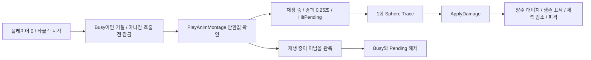

# 3인칭 근접전 첫 연결 실험

UE 5.8.4 / CL 58902052에서 **일반 Engine Blueprint로 공격·타격·피격·체력·공격 상태 복귀를 구현하고, 대표 정상 흐름과 중요한 실패 경계를 실제 PIE로 확인했다.** 단일 플레이어의 비무장 연습용 구현이며 게임 전체의 완성을 뜻하지 않는다.

후속 리뷰에서 확인한 **동기 Montage 콜백 재진입 P2 두 건을 수정했다.** `TryStudyAttack`은 재생 호출 전에 공격 잠금을 잡고, 치명타는 피격 재생 전에 사망 플래그를 확정한다. 공식 MCP 8002의 실제 콜백에서 재진입 공격은 거절되어 최종 공격 1회, 치명타 중 추가 대미지는 거절되어 체력 0·대미지 이벤트 1회를 확인했다. 재생 실패의 잠금 해제와 저장·재로드 후 일반 입력도 통과했다. 원 실패 `review-attack-reentry.json`·`review-fatal-reentry.json`은 보존하며 후속 성공으로 덮어쓰지 않는다. 현재 근거는 기존 기능군 `report.json.p2_reentry_fix`에 통합했다.

## 소유 구현과 원본

에셋은 `/Game/Study/GameAnimationSample/Melee/`에 있다.

| 소유 에셋 | 역할과 출처 |
|---|---|
| `AM_StudyAttack` | 설치된 `Characters/Mannequins/Anims/Unarmed/Attack/MM_Attack_01`에서 표준 AnimMontageFactory로 생성. 길이 1초 |
| `AM_StudyHit` | 설치된 `MM_HitReact_Front_Lgt_01`에서 생성한 피격 Montage |
| `BP_MeleeStudyCharacter` | 기존 `ThirdPerson/Blueprints/BP_ThirdPersonCharacter`를 부모로 하는 새 자식. 이동·카메라·기본 입력을 상속하고 공격 그래프를 추가 |
| `BP_MeleeStudyTarget` | 표준 Character 기반의 연습용 표적. 기존 Quinn Simple mesh와 ABP_Unarmed, 체력 100·피격 처리를 사용 |
| `GM_MeleeStudy` | 기존 ThirdPerson GameMode의 소유 자식. 기본 폰은 위 소유 플레이어 |
| `/Game/Study/GameAnimationSample/Maps/L_MeleeLab` | 소유 복사 맵에 위 GameMode·PlayerStart·표적을 배치. 다른 레벨의 기본 게임 모드는 변경하지 않음 |

Melee는 기존 ThirdPerson CMC/Mannequin 경로를 사용한다. 앞선 Traversal의 UEFN Mover 폰에 이 공격을 검증했다고 표현하지 않는다. 공격·피격 skeleton은 SK_Mannequin이며, 실제 ABP_Unarmed에 `DefaultSlot`이 있는 것을 확인했다. 원본 애니메이션·원본 ThirdPerson Blueprint를 수정하지 않았다.

## 작성한 동작 계약

- 기본 공격력은 20이다. 공격 중 추가 공격을 거절한다. Busy는 Montage 호출 전에 true, Pending은 false로 설정해 동기 콜백의 재진입을 막는다. 반환 후 자신이 유효하고 재생 결과가 양수이면 타격 대기·시작 시간·공격 횟수를 확정한다. 재생 실패 시 Busy/Pending을 해제하고 공격 횟수는 증가시키지 않는다.
- Tick은 현재 Montage가 재생 중인 조건에서만 타격 시점을 처리한다. 경과 0.25초가 지나면 Pending을 먼저 해제하고 한 번 trace한다. 긴 프레임으로 재생이 이미 끝났다면 뒤늦은 타격을 발생시키지 않는다.
- trace는 Actor 중심에서 전방 55→165cm, 반경 35cm의 Visibility 구체 trace이며 자신은 무시한다. 현재는 프레임 간 무기 궤적 sweep이 아니다.
- 유효한 hit Actor에 ApplyDamage를 호출한다. 반환 후 소스 Actor의 유효성을 다시 확인한다. `HitCount`는 양수 ApplyDamage 반환 횟수이며 실제 표적 체력 감소의 독립 증거가 아니다.
- 표적은 양수 대미지와 생존 상태에서만 체력을 감소시키며 0 아래로 내리지 않는다. DamageEvents/LastDamage를 갱신하고 체력이 0이면 IsDead를 확정한 다음 피격 Montage를 재생한다. 그 동기 콜백에서 들어온 추가 대미지도 사망 상태로 거절한다. Montage 반환 후 사망 상태를 다시 덮어쓰지 않는다.
- 자연 종료와 외부 중단의 원인을 delegate로 구분한 구현은 아니다. `AttackFinishedObservedCount`는 재생 중이 아님을 관측한 횟수다. `AttackInterruptedCount`·`IgnoredDamageCount`는 현재 갱신하지 않는 예약 필드이므로 판정에 사용하지 않는다.

`StudyAttack` custom event는 `TryStudyAttack`으로 연결되고, 실제 Tick은 `StudyMeleeTick`, 표적 ReceiveAnyDamage는 `StudyReceiveDamage`로 연결됐다. 핵심 함수는 일반 Blueprint 함수이며 런타임 Python/MCP 호출을 넣지 않았다.

## 실제 검수 결과

두 Montage와 Blueprint·소유 GameMode/맵의 저장·로드, DefaultSlot, 컴파일 UP_TO_DATE와 직접 의존성을 확인했다. 공식 MCP 8002에서 표준 입력·엔진 API를 사용한 실제 결과는 다음과 같다.

| 경우 | 실제 결과 |
|---|---|
| 정상 공격·공격 중 연타·이동 복귀 | 공격 횟수 1, 표적 체력 100→80, 대미지 이벤트 1, 공격·피격 Montage 관측, Busy/Pending 해제 후 옆으로 이동 확인 |
| 빗맞음 | 공격 1, 체력 100·대미지 이벤트 0, 상태 복원 |
| 타격 전 명시적 Montage 중단 | 타격 창 전에 Stop 진입·반환 확인, 체력 100·대미지 이벤트 0, Busy/Pending 해제 |
| 타격 전 표적 소멸 | 소유 PIE 표적만 파괴, 이후 trace 대미지 전달 0·상태 복원. 저장된 맵의 표적은 유지 |
| 사망 후 입력 | 공격 6회에 대미지 이벤트 5회, 체력 0·IsDead true 유지. 여섯 번째 ApplyDamage 양수 반환과 실제 체력 처리 제외를 구분 |
| 이전 Montage 블렌드아웃 중 공격 재진입 | 콜백 진입 시 Busy true, 중첩 호출의 공격 횟수 증가 0. 최종 공격 1회·체력 80·피격 1회, 상태 복원 |
| 치명타 피격 Montage 콜백의 추가 대미지 | 콜백 진입 시 체력 0·IsDead true·대미지 이벤트 1. 추가 ApplyDamage 반환 20과 실제 체력 처리 거절을 구분하며 이벤트는 1로 유지 |
| AnimInstance가 없어 재생 실패 | 소유 PIE 인스턴스에서 엔진 재생 반환 0 확인. Busy/Pending false·공격 횟수 0, AnimInstance 복원 후 다음 공격 승인 |

이번 수정에서는 위 재진입 두 경계와 재생 실패를 확인하고, 저장·재로드 후 정상 공격·연타 거절·옆 이동 복귀를 다시 확인했다. 나머지 기존 정상·취소·표적 소멸 증거는 재사용했다. `StudyReceiveDamage`의 Amount 데이터 핀 때문에 공식 DSL writer가 보존한 이전 본문 26개 노드는 실행 연결이 끊긴 것을 확인한 뒤 정리했다. 현재 실행 본문 27개 노드와 다른 함수·EventGraph 연결은 유지했다.

재로드 검수에서 DSL 문자열 전체 비교는 기본 재생률 `1.0`의 생략 표기 때문에 실패했다. 실제 핀 값과 실행 순서를 확인해 구분했고, 전체 노드 수로 Montage 호출 1개를 가정한 검사도 연결이 끊긴 이전 본문을 함께 세고 있었다. 원 검사 실패를 보존했다. 검수용 메뉴·스키마 조회가 만든 dirty 상태는 디스크 해시 확인 후 정확한 소유 두 패키지만 다시 로드했으며 원본이나 사용자 에셋을 저장하지 않았다.

처음 정상 기록의 마지막 전진 검사는 표적 캡슐에 막혔다. 실제 반경 합 69cm와 정지 거리 약 69.05cm, 해제된 Busy/Pending을 확인해 상태 고착과 구분했다. 원 실패는 유지하고 옆으로 이동하는 후속 경계를 확인했다. 원본 정상 기록의 공격·피격 성공을 실패 기록 전체의 성공으로 바꾸지는 않았다.

처음 표적은 표준 Pawn 캡슐의 Visibility Ignore 설정을 상속했다. 현재 공격 trace와 맞지 않아 소유 표적 CDO·맵 인스턴스만 Visibility Block으로 수리했다. 새 프로세스에서도 CDO와 배치 표적의 Block, 기본 체력 100·공격력 20, 맵 GameMode와 기본 폰을 다시 확인했다. 원본 Character/프로파일은 수정하지 않았다.

직접 사용하려면 `L_MeleeLab`을 열고 PIE를 시작한다. WASD로 이동하고 좌클릭으로 전방 표적을 공격한다. 표적은 시작 시 전방 약 180cm에 있고 공격력은 20이다. 체력·Busy/Pending 등은 Blueprint 디버거의 해당 PIE 인스턴스나 속성 읽기 API로 확인한다. 체력 HUD는 아직 없다. 각 PIE를 종료하면 테스트 중 파괴·체력 변경은 저장 에셋에 반영되지 않는다. 기존 맵을 임의로 저장하지 않는다.

키·관측 callback은 해제했고 검증 에디터의 정상 종료를 확인했다. 패키징이나 MCP 비활성 게임 실행은 이번에 수행하지 않았으며, 직접 의존성 확인과 동등하게 취급하지 않는다.

사망은 현재 체력 0·IsDead·후속 체력 처리 거절을 뜻하며 사망 연출이나 자동 Actor 정리는 없다. 콤보·무기 소켓 sweep·히트스톱·방어·피격 우선순위·공격자의 체력·적 AI·멀티플레이는 이번 초기 연결의 구현 범위가 아니다.

## 저작 실패와 해결 경험

- BlueprintTools의 `asset_type`에는 Python 클래스 자체가 아닌 실제 UClass를 전달한다. native Character는 `Character.static_class()`를 사용했다. 실패 후 기존 플레이어·저장된 Montage·없는 표적을 확인한 뒤 남은 생성만 수행했다.
- 한국어 메뉴에서는 공식 DSL의 영문 내장 연산자 이름 일부가 노드 목록과 맞지 않았다. 소유 테스트 에디터에만 `set_current_culture('en', False)`를 적용했다. 사용자 메인이나 저장 설정을 바꾸지 않았다.
- SDK가 내부 DSL 오류를 기본 반환으로 감출 수 있어 `toolset_registry.tool_raising_exceptions()`로 예외를 전달하고 실제 노드 수를 관측했다. 원 실패·빈 본문과 이후 구현은 각각 보존했다.
- `Utilities|IsValid`는 이 문맥에서 exec macro였다. 실제 InputObject·Is Valid/Is Not Valid 핀을 확인하고, 여러 exec 경로는 Sequence로 분리했다. 단순 boolean 반환 함수로 가정하지 않았다.

원시 기록과 저작 코드는 로컬 `cubeless/records/operations/game-animation-warping-melee-20261028/`에 있다. 같은 작업자가 실제 행동 검수와 자체 검토를 수행했으며 독립 QA는 아니다. Git stage·commit·push는 하지 않았다.
