# 장애물 넘기·오르기와 Motion Warping 목표 수명

설치 UE **5.8.4 / CL 58902052**의 Game Animation Sample을 실제 실행한 기록이다. 지원 소스 계열은 UE 5.8.x이며 다른 패치의 같은 동작을 자동 보증하지 않는다. 이번에는 기존 도구와 공개 엔진 API를 조합했으며 새 MCP 도구나 게임플레이 C++를 추가하지 않았다.

## 원문·설치 구현·소유 예제

- [Epic Motion Warping 설명](https://dev.epicgames.com/documentation/en-us/unreal-engine/motion-warping-in-unreal-engine): Montage의 Notify 창과 이름 있는 목표를 연결해 root motion을 조정하는 구조다. MotionWarping 플러그인 활성화가 전제다.
- 실제 샘플: `/Game/Blueprints/AC_TraversalLogic`, `SandboxCharacter_Mover`, `/Game/Levels/LevelPrototyping/LevelBlock_Traversable`.
- 소유 맵: `/Game/Study/GameAnimationSample/Maps/L_TraversalLab`. DefaultLevel의 복사본이며 원본 파일 해시는 보존했다.
- 설치 소스: `Engine/Plugins/Animation/MotionWarping/Source/MotionWarping/Public/MotionWarpingComponent.h`, `RootMotionModifier.h` 및 대응 Private 구현.
- Mover의 백엔드: `Engine/Plugins/Runtime/NetworkPrediction/Source/NetworkPrediction/Private/NetworkPredictionWorldManager.cpp`.

이 예제는 기존 샘플의 캐릭터·애니메이션·Struct·Chooser·Blueprint와 표준 엔진 플러그인에 의존한다. 맵 하나만 다른 프로젝트에 복사하면 완성되는 기능이 아니다. Cubeless·공식 MCP는 저작/관측에 사용했으며 런타임에서 호출하도록 에셋을 작성하지 않았다.

## 실제 호출과 데이터 흐름

```mermaid
flowchart LR
    Input[SpaceBar / Traverse 입력] --> Check[CanDoTraversal / GetTraversalCheckInputs]
    Check --> Trace[AC_TraversalLogic.TryTraversalAction]
    Trace --> Ledge[LevelBlock_Traversable.GetLedgeTransforms]
    Ledge --> Select[높이·깊이·착지 공간 / Montage 선택]
    Select --> Targets[SetWarpTargets]
    Targets --> Play[PerformTraversalAction_Mover]
    Play --> Pose[Motion Warping 창 / Root Motion / 실제 이동]
    Pose --> Exit[DoingTraversalAction·이동 모드·충돌 복원]
```



`TryTraversalAction`은 앞쪽 capsule trace, 앞·뒤 ledge, 상단 공간, 뒤쪽 바닥을 확인한다. 첫 trace의 `TraceTypeQuery3`은 현재 프로젝트의 `Traversable` 채널 설정과 함께 사용된다. 이 샘플은 hit Actor를 **LevelBlock_Traversable로 Cast**한 뒤 spline 기반 `GetLedgeTransforms`를 호출한다. 따라서 단순 StaticMeshActor 상자를 놓는 것만으로 이 샘플의 traversal 입력 계약을 충족하지 않는다. 이는 샘플의 장애물 판정 설계이며 Motion Warping 엔진 자체가 그 Blueprint를 요구한다는 뜻은 아니다.

`LevelBlock_Traversable`에는 네 ledge spline과 반대 ledge 맵이 있다. Actor 전체 bounds는 Billboard·Text·Spline 때문에 실제 충돌 상자보다 클 수 있었다. 이번 대상 선택에는 **colliding bounds**와 실제 spline 좌표를 사용했다.

`SetWarpTargets`는 다음을 구분한다.

- `FrontLedge`: 앞 ledge 위치·방향에서 생성/갱신.
- `BackLedge`: 액션과 해당 Montage의 Warp 창에 따라 생성/갱신 또는 제거.
- `BackFloor`: 뒤쪽 바닥과 해당 Warp 창 조건에 따라 생성/갱신 또는 제거.

Actor 원점·capsule 중심·root bone·손의 warp point·목표는 서로 다른 좌표다. 단순히 Actor 위치가 목표와 같아야 한다는 검사를 사용하지 않는다.

## 실제 사용한 두 장애물

| 소유 맵의 Actor | 충돌 치수와 배치 | 실제 선택 |
|---|---|---|
| `Study_Traversal_Low100` | 깊이 20 / 폭 200 / 높이 100cm, 앞면 x=2400, y=-800 | `Hurdle`, `AM_M_Relaxed_Traversal_Hurdle_1_0_run_F_Rfoot` |
| `Study_Traversal_High250` | 깊이 600 / 폭 200 / 높이 250cm, 앞면 x=2400, y=-1600 | `Mantle`, `AM_M_Relaxed_Traversal_Climb_Start_2_5_run_F_Rfoot` |

기본 PlayerStart는 낮은 장애물 앞 `(2180, -800, 90)`, yaw 0이다. W로 접근한 뒤 SpaceBar로 시작했다. 높은 장애물 실험에서는 **소유 맵의 PlayerStart만** y=-1600으로 바꿨으며 검증 후 기본 위치로 복원했다. 원본 장애물 Blueprint나 원본 맵을 수정하지 않는다.

낮은 장애물의 실제 trace 결과는 높이 약 97.725cm, 깊이 약 20cm였다. 앞 ledge는 `(2400,-800,100)`, 뒤 ledge는 `(2420,-800,100)`, 뒤 바닥 trace는 `(2452,-800,0.125)`였다. 최종 `BackFloor` warp target은 애니메이션 보정 계산을 거쳐 약 `(2534.207,-800,0.125)`로 설정됐다. trace 지점을 그대로 최종 Actor 위치라고 설명하지 않는다.

Hurdle의 실제 Warp 창은 약 0.5042~0.9230초의 `FrontLedge`, 1.0495~1.3397초의 `BackFloor`였다. 앞 창은 `attach` bone provider를 사용했고, translation/rotation warping과 feet 기준 보정이 켜져 있었으며 Z를 무시하지 않았다. 이것은 **에셋 Notify modifier template 설정**을 읽은 결과다. template의 currentPosition/weight를 활성 solver의 현재 값으로 해석하지 않는다.

## 정상 이동의 실제 결과

- Hurdle은 뒤쪽 면을 통과했다. 종료 경계 Actor x≈2559.50, 이후 정지 시 x≈2701.94였고 최대 Actor z≈188.37이었다. `DoingTraversalAction=false`, OnGround, 활성 Montage 없음, ignore component 목록과 WorldDynamic 응답이 시작값으로 복원됐다.
- Mantle은 250cm 상단에 올라갔다. 실제 최종 Actor는 약 `(2459.58,-1600,338.50)`, root z≈250.50이었으며 OnGround·활성 Montage 없음·충돌 복원을 관측했다. `traversal-high-60fps-runtime.json`의 마지막 실제 상태를 근거로 판단했다.
- 주입한 키와 관측 delegate/callback은 해제했다. 캡처는 실제 D3D12 렌더 프레임이다. 활성 시점에 비동기로 예약한 캡처이므로 파일명만으로 정확한 Montage 시간을 단정하지 않는다.

### Montage 중단과 액션 목표 도달은 별개다

Hurdle에는 `Force Blend Out`, 선택된 Climb에는 `With Movement Input` 조건의 `BP_NotifyState_MontageBlendOut`이 있었다. 이 Notify는 실제로 `Montage_StopWithBlendSettings`를 호출한다. 따라서 `OnMontageEnded(interrupted=true)`를 액션 목표 실패의 충분조건으로 삼으면 정상적인 목표 도달도 거절할 수 있다.

Mantle 기록기는 Force 조건만 허용하는 잘못된 검사로 실패했다. 원시 실패는 그대로 두고, 이미 수집된 실제 위치·이동 모드·doing 플래그·충돌 상태로 **목표 도달**을 확인했다. 이 정상 액션을 다시 실행하지 않았다. 원시 interrupted 값도 true로 유지하며 자연 종료로 바꾸지 않았다. Notify의 정확한 호출 스택이나 모든 Montage instance ID를 독립 추적했다는 주장은 하지 않는다.

명시적 취소는 별도로 Stop 요청 진입/반환, 그 요청 **이후**의 해당 Montage 콜백, 실제 활성 상태와 충돌 복원을 확인한다. 같은 asset의 이전 종료 이벤트를 새 Stop의 응답으로 사용하지 않는다. 최종 취소 실험은 Stop 진입 약 0.672초, 그 이후 중단 콜백 약 0.765초를 관측했다. 최종 Actor는 x≈2338.46/z≈88.51로 장애물 앞 지면에 있었고, Idle·OnGround·활성 Montage 없음·충돌 시작값 복원을 확인했다. 그보다 앞선 약 0.562초의 같은 asset 이벤트는 취소 응답에서 제외했다. 샘플/Mover에서는 같은 asset의 종료 이벤트가 여러 번 보일 수 있으므로 asset 이름 일치만으로 판정하지 않는다.

## 목표 생성·갱신·제거와 참조 수명

액션 종료 후 `FrontLedge` 등의 이름 있는 목표가 남아 있는 것을 관측했다. 샘플은 다음 액션에서 이를 갱신하거나 불필요한 이름을 제거한다. **활성 Montage가 끝났다는 사실과 target entry 삭제는 별개의 상태**다. 이를 곧바로 메모리 누수로 분류하지 않았다.

별도의 소유 이름 `Study_WarpLifecycle_20261028`만 사용한 실험에서는 다음을 확인했다. 샘플의 세 목표를 임의로 제거하지 않았다.

1. location 기반 생성과 같은 이름의 location 갱신.
2. 소유 `Study_WarpAnchor` 컴포넌트를 참조하고 `follow_component=true`로 갱신.
3. Movable 앵커의 실제 x가 2100→2150으로 이동하고 참조된 컴포넌트 위치가 바뀌는 것을 확인.
4. PIE 앵커 Actor를 명시적으로 파괴한 뒤 target entry는 남고 weak component는 None이 되는 것을 확인.
5. 명시적 `remove_warp_target` 반환 1, 재차 제거 반환 0, 이후 조회 found=false 확인.

처음 앵커는 Static이라 이동이 거절됐다. 실패 이후 실제 위치·mobility·존재하는 target과 비활성 관측기를 확인했다. 새 요청은 그 **확인된 부분 상태에서** Movable로 바꾸고 후속 단계만 진행했다. 원 생성/갱신 요청 전체를 재실행하거나 원 실패를 성공으로 바꾸지 않았다. 최종 소유 맵의 앵커도 Movable로 저장하고 새 메인 프로세스에서 재로드를 확인했다.

`FMotionWarpingTarget.location`은 컴포넌트 기반 생성 시점의 저장값이다. 이번 실제 이동 후 저장 location x는 2100, component의 현재 x는 2150이었다. 설치 C++의 `GetTargetTrasform()`은 follow/weak 참조 조건으로 최종 transform을 계산하며, component가 유효하지 않으면 저장된 transform을 사용한다. 공개 Python 관측은 저장값·컴포넌트 실제 위치·weak 유효성을 확인한 것이며, 동적 최종 transform getter나 움직이는 발판을 통과하는 실제 solver 품질까지 측정한 결과는 아니다.

## 재사용할 공개 API

`MotionWarping` 활성화·로드가 필요하다. 소유 PIE 컴포넌트 `mw`와 이름 충돌 없는 `name`을 대상으로 한다. 원래 샘플의 FrontLedge 등을 덮어쓰지 않는다.

```python
mw.add_or_update_warp_target_from_location(name, unreal.Vector(100, 0, 50))
target, found = mw.find_warp_target(name)
mw.add_or_update_warp_target_from_location(name, unreal.Vector(125, 0, 50))
mw.add_or_update_warp_target_from_component(name, movable_component, 'None', True)
# 실제 목표·소유권·현재 Montage 상태를 확인한 다음 필요한 시점에만 제거한다.
removed = mw.remove_warp_target(name)
```

설치 5.8.4에서 위 메서드의 실제 Python 노출과 호출을 확인했다. `find_warp_target`의 BlueprintCallable 오버로드는 설치 헤더에서 experimental로 표시돼 있으므로 이후 엔진 변경 시 다시 확인한다. `GetWarpTargets()`/`GetModifiers()`의 C++ 공개 선언이 Python에도 같은 이름으로 노출된다고 가정하지 않는다.

Montage Notify 목록은 일반 `get_editor_property('notifies')`가 protected 읽기를 거절했다. 이를 우회하지 않고 기존 Cubeless 메타데이터 도구와 공개 `MotionWarpingUtilities.get_motion_warping_windows_from_animation`을 사용했다. 설치 `UAnimationBlueprintLibrary`의 Python ScriptName은 `AnimationLibrary`다. C++ 클래스명을 그대로 Python 이름으로 가정하지 않는다.

## 실행 조건과 검수기 수리

처음 백그라운드 실행은 약 333ms 간격이었다. 설치 NetworkPrediction의 independent tick은 DeltaSimMS를 최대 100ms로 제한한다. 그 실행은 목표/재생을 시작했지만 장애물을 넘지 못했으므로 통과 증거로 쓰지 않았다. 별도 **렌더링 가능한** unattended Editor에서 Editor CPU throttle을 피하고 `t.MaxFPS 60` 상한을 적용해 실제 통과를 확인했다. NullRHI나 서버 전용 실행이 아니다. 실제 프레임 간격·capture 정지·cold loading 비용은 원시 기록에 있으며 60FPS 고정 달성이나 애니메이션 CPU/GPU 성능 향상을 주장하지 않는다.

비동기 맵 열기에서는 바깥 결과의 `stage=complete`가 상태 조회 함수의 완료일 뿐이었다. 검증 실행기가 이를 실제 맵 로드 완료로 오인해 Entry에서 PIE를 시작한 실패도 보존했다. 수정 후에는 다음 세 가지를 함께 확인하고 입력을 보냈다.

- `data_json.legacy_result.pending == false`
- `last_open_status.loaded == true`
- `current_world_package_name_now`가 요청한 소유 맵과 일치

취소 기록기의 첫 판정 역시 이전 같은 asset의 종료 이벤트를 너무 일찍 검사했다. Stop 시각 이후 이벤트를 기다리도록 수정했고, 해당 시간 경계에서는 비동기 high-res capture를 끼워 넣지 않는다. 화면 캡처 비용과 게임 상태 전환 시간을 혼합하지 않는다.

## 범위와 기록

이번 대표 범위는 위 Hurdle·Mantle, 목표 참조 수명, 빈 trace의 점프 fallback과 명시적 취소 경계다. 모든 높이·깊이·체형·네트워크 rollback·moving platform·멀티 참가자·solver modifier 수명 전체를 완료한 것은 아니다. 패키징이나 MCP 비활성 독립 실행을 다시 수행한 것도 아니다.

공식 MCP 8000의 검증 빌드는 실제 메인 프로젝트에 적용돼 있다. 별도 실험은 공식 MCP 8002의 소유 AnimRuntime58에서 수행한 뒤 정상 종료·LogExit를 확인했다. 메인은 일반 창으로 열고 소유 맵을 디스크에서 다시 로드한 뒤 원래 DefaultLevel·카메라로 복원했으며 PIE false·dirty 0이다. 로컬 보조 코드·원시 성공/실패·캡처·복구 DLL은 `cubeless/records/operations/game-animation-sample-study-20261028/`에 있으며 Git 제외 대상이다. 이 문서와 소유 맵은 Git에 포함할 수 있지만 이번 작업에서는 stage·commit·push를 하지 않는다.
